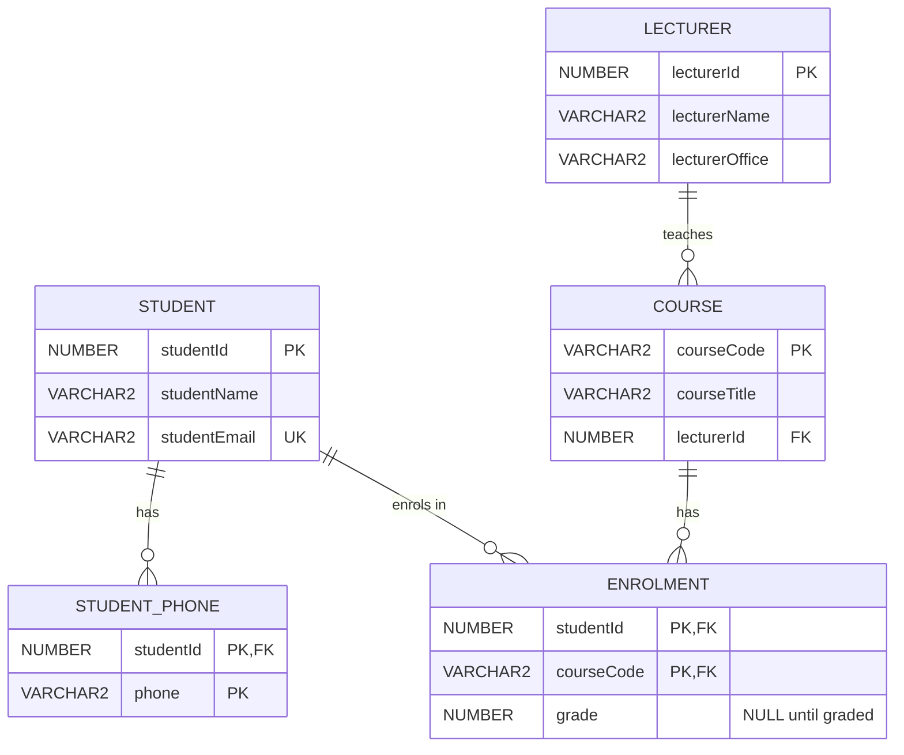

# Student Enrolment Database (Oracle SQL and PL/SQL)

A normalised (3NF) Oracle database for a student enrolment system.
The project contains queries for business questions, a stored procedure and a trigger that audits grade changes.
The scripts are rerunnable.

## Data model

## Design decisions

- Normalisation:
  - I created an initial table of all relevant data values that a student and lecturer would have, along with courses and their grades.
  - 1NF: Initially removed phone numbers into its own table since students can have multiple contacts.
  - 2NF: After this, Student and Course tables were created for their details since they only depended on part of the (StudentID, CourseCode) key.
  - 3NF: Lecturer details were moved to Lecturer &rarr; a lecturer can teach multiple courses but a course can only have one lecturer.
- Grade remains nullable because students enrol into courses before obtaining a mark.
- Phone numbers are text since they begin with zero and would not be formatted correctly with NUMBER.
- Enrolment contains an index for courseCode to search directly for the relevant students for courses. This was created since Oracle does not automatically index foreign keys.
- The audit table grade_audit has no foreign key so that all grade changes are saved and trackable even if a student is deleted.

## Project Files

| File | What it shows |
| --- | --- |
| `schema.sql` | Tables, keys, CHECK/UNIQUE constraints, an index, the audit table |
| `seed.sql` | Sample data |
| `queries.sql` | JOIN, GROUP BY with HAVING, LEFT JOIN counts, NOT EXISTS, correlated subquery |
| `plsql/cursor_student_course_counts.sql` | Explicit cursor loop |
| `plsql/procedure_get_course_stats.sql` | Stored procedure with IN/OUT parameters and a custom error |
| `plsql/trigger_trg_grade_audit.sql` | Row-level trigger that audits grade changes |

## How to run

1. Open [Oracle Live SQL](https://livesql.oracle.com) (free) or any Oracle 23ai database.
2. Run `schema.sql`, then `seed.sql`.
3. Run `queries.sql` and the files in `plsql/` in order.

## Next

An ASP.NET Core Web API with EF Core on top of this schema is coming next.
